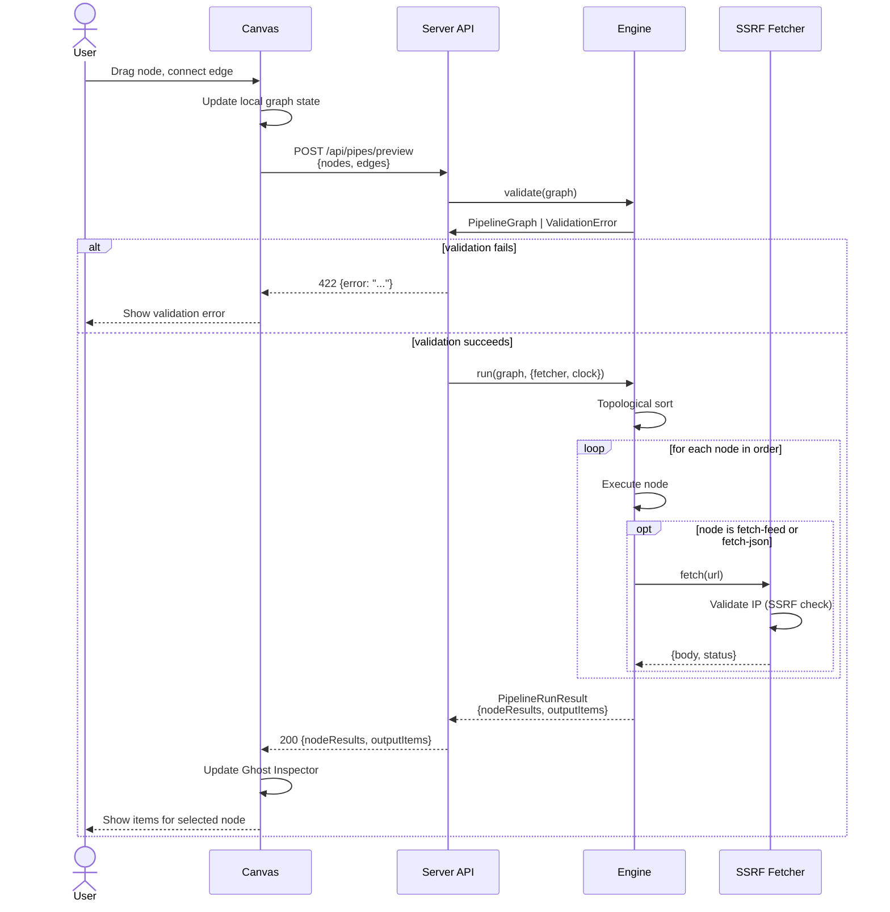
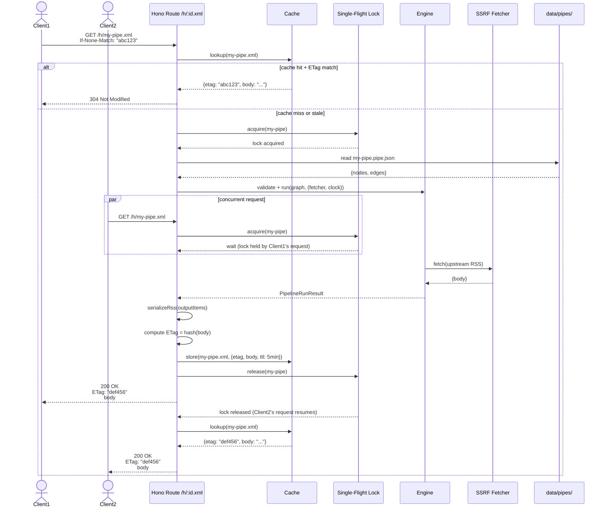

# Revenant MVP — Design

## Overview

Revenant is a three-tier system: a pure TypeScript execution **engine** (no I/O), a **server** (Hono HTTP API + SSRF-safe fetcher + Haunting cache), and a **web** editor (React 19 + @xyflow/react canvas). The engine accepts a `PipelineGraph` and executes modules in topological order, isolating errors per node. All side effects (fetch, clock) are injected via interfaces, making the engine deterministic and testable.

The server exposes RESTful CRUD endpoints for pipeline management, a `/run` endpoint for live preview with per-node results, and stable `/h/<id>.*` Haunting URLs for RSS/Atom/JSON Feed output with ETag/304 caching and single-flight request de-duplication. The web editor provides a drag-and-drop canvas with a **Ghost Inspector** pane showing items after each node, plus themed Halloween labels for all modules.

Pipelines are stored as `*.pipe.json` files on disk (no database). The schema is validated with Zod on every load and save. The engine's module system is extensible: each operator is a single file exporting a `ModuleDefinition` with config schema, port declarations, and a pure `execute` function.

---

## Architecture

```mermaid
graph TB
    subgraph web["Web (React 19 + Vite)"]
        Canvas["Canvas (@xyflow/react)"]
        ConfigPanel["Config Panel"]
        GhostInspector["Ghost Inspector"]
        PipelineStore["Pipeline State (Zustand)"]
    end

    subgraph server["Server (Hono)"]
        API["API Routes<br/>/api/pipes/*"]
        Haunting["Haunting Routes<br/>/h/:id.*"]
        Cache["Cache<br/>(ETag + TTL + Single-Flight)"]
        SSRFFetcher["SSRF-Safe Fetcher"]
        SystemClock["System Clock"]
    end

    subgraph engine["Engine (Pure TS Library)"]
        DAGValidator["DAG Validator"]
        Runner["Runner (Topological Sort)"]
        Modules["Modules<br/>(filter, sort, union, etc.)"]
        Serializers["Serializers<br/>(RSS/Atom/JSON Feed)"]
    end

    subgraph storage["Storage"]
        PipeFiles["data/pipes/*.pipe.json"]
    end

    Canvas -->|POST /api/pipes/preview| API
    Canvas -->|GET/PUT /api/pipes/:id| API
    API -->|load/save| PipeFiles
    API -->|validate + run| DAGValidator
    Haunting -->|load| PipeFiles
    Haunting -->|check| Cache
    Haunting -->|execute| Runner
    Runner -->|validate| DAGValidator
    Runner -->|call execute()| Modules
    Runner -->|inject| SSRFFetcher
    Runner -->|inject| SystemClock
    Modules -->|fetch via| SSRFFetcher
    Modules -->|date via| SystemClock
    Haunting -->|serialize| Serializers
    Serializers -->|RSS/Atom/JSON| Haunting
```

### Dependency Flow

- **engine** has zero runtime dependencies on server or web. It accepts `Fetcher` and `Clock` interfaces.
- **server** imports engine and provides concrete `SSRFFetcher` and `SystemClock` implementations.
- **web** calls server HTTP endpoints only; no direct engine import (keeps bundle size small).

---

## Sequence Diagrams

### 1. Editor Preview Run



### 2. Haunting Request with ETag/304, TTL Cache, Single-Flight



---

## Components and Interfaces

### Core Engine Types

```typescript
// packages/engine/src/types.ts

/** Base item model — all operators produce/consume Item[] */
export interface Item {
  title: string;
  link: string;
  guid: string;
  date: string; // ISO 8601
  content?: string;
  extra?: Record<string, any>; // Pass-through for custom fields
}

export const ItemSchema = z.object({
  title: z.string(),
  link: z.string(), // Relaxed from .url() per Req 3.4 (guid fallback when link is empty)
  guid: z.string(),
  date: z.string().datetime(),
  content: z.string().optional(),
  extra: z.record(z.any()).optional().default({}),
});

/** Derive a stable GUID for an item. Per Req 3.4:
 *  Use source's guid/id if present, else link if present,
 *  else sha1 hash of title+date for deterministic deduplication. */
export function deriveGuid(
  item: { link?: string; guid?: string; title: string; date: string }
): string {
  if (item.guid) return item.guid;
  if (item.link) return item.link;
  const crypto = require('crypto');
  return crypto.createHash('sha1').update(item.title + item.date).digest('hex');
}

/** Module definition — each operator file exports one of these */
export interface ModuleDefinition<TConfig = any, TInput = any, TOutput = any> {
  type: string; // e.g. 'filter', 'sort', 'fetch-feed'
  category?: 'sources' | 'operators' | 'output'; // For UI palette grouping
  themedLabel: string; // e.g. 'Banish'
  plainLabel: string; // e.g. 'Filter'
  configSchema: z.ZodSchema<TConfig>;
  inputPorts: string[]; // e.g. ['items'] or ['items1', 'items2']
  outputPorts: string[]; // e.g. ['out'] or ['matched', 'unmatched']
  execute(
    inputs: Record<string, any>, // port name → value
    config: TConfig,
    deps: ExecutionDeps
  ): Promise<Record<string, any>> | Record<string, any>; // port name → output value
}

/** Injected dependencies for deterministic execution */
export interface ExecutionDeps {
  fetcher: Fetcher;
  clock: Clock;
  registry: Map<string, ModuleDefinition>; // Injected module registry
}

export interface Fetcher {
  fetch(url: string): Promise<FetchResult>;
}

export interface FetchResult {
  body: string;
  status: number;
  headers: Record<string, string>;
}

export interface Clock {
  now(): Date;
}

/** Validated pipeline graph ready for execution */
export interface PipelineGraph {
  nodes: Array<{
    id: string;
    type: string;
    config: any;
    position: { x: number; y: number };
  }>;
  edges: Array<{
    source: string;
    sourcePort: string;
    target: string;
    targetPort: string;
  }>;
  meta: {
    id: string; // slug
    name: string;
  };
}

export const PipelineGraphSchema = z.object({
  nodes: z.array(
    z.object({
      id: z.string(),
      type: z.string(),
      config: z.any(),
      position: z.object({ x: z.number(), y: z.number() }),
    })
  ),
  edges: z.array(
    z.object({
      source: z.string(),
      sourcePort: z.string(),
      target: z.string(),
      targetPort: z.string(),
    })
  ),
  meta: z.object({
    id: z.string().regex(/^[a-z0-9-]+$/), // slug format
    name: z.string().min(1),
  }),
});

/** Result of a pipeline run — per-node items + final output */
export interface PipelineRunResult {
  success: boolean;
  nodeResults: Record<
    string,
    {
      items: Item[];
      error?: { message: string };
    }
  >;
  outputItems: Item[];
}
```

### DAG Validator

```typescript
// packages/engine/src/dag/validator.ts

export interface ValidationError {
  message: string;
  path?: string[]; // e.g. ['nodes', '2', 'config', 'url']
}

export function validate(
  json: unknown,
  moduleRegistry: Map<string, ModuleDefinition>
): { success: true; graph: PipelineGraph } | { success: false; errors: ValidationError[] } {
  // 1. Validate JSON structure with PipelineGraphSchema
  // 2. Check all node types exist in moduleRegistry
  // 3. Validate each node's config against its module's configSchema
  // 4. Check for cycles (DFS with recursion stack)
  // 5. Ensure exactly one node has type 'output'
  // 6. Validate port names (sourcePort exists in source node's outputPorts, etc.)
  // 7. Return typed PipelineGraph or array of ValidationError
}

export function topologicalSort(graph: PipelineGraph): string[] {
  // Kahn's algorithm — returns node IDs in execution order
  // Throws if cycle detected (should not happen after validate())
}
```

### Runner

```typescript
// packages/engine/src/runner/run.ts

export async function run(
  graph: PipelineGraph,
  deps: ExecutionDeps & { registry: Map<string, ModuleDefinition> },
  signal?: AbortSignal
): Promise<PipelineRunResult> {
  const order = topologicalSort(graph);
  const nodeResults: Record<string, { items: Item[]; error?: { message: string } }> = {};

  for (const nodeId of order) {
    if (signal?.aborted) {
      throw new Error('Pipeline execution timeout');
    }

    const node = graph.nodes.find((n) => n.id === nodeId)!;
    const moduleDef = deps.registry.get(node.type)!;

    // Gather inputs from upstream nodes via edges
    const inputs: Record<string, Item[]> = {};
    let hasFailedUpstream = false;
    let allInputsFailed = true;

    for (const edge of graph.edges.filter((e) => e.target === nodeId)) {
      const sourceResult = nodeResults[edge.source];
      if (sourceResult?.error) {
        hasFailedUpstream = true;
        // Treat failed input as empty array (Req 2.2)
        inputs[edge.targetPort] = [];
      } else {
        allInputsFailed = false;
        inputs[edge.targetPort] = sourceResult?.items ?? [];
      }
    }

    // If all connected inputs are failed, propagate the error (Req 2.2)
    if (allInputsFailed && hasFailedUpstream) {
      const firstFailedEdge = graph.edges.find(
        (e) => e.target === nodeId && nodeResults[e.source]?.error
      );
      const upstreamError = nodeResults[firstFailedEdge!.source]!.error!;
      nodeResults[nodeId] = { items: [], error: upstreamError };
      continue;
    }

    try {
      const outputs = await moduleDef.execute(inputs, node.config, deps);
      const outItems = outputs.out ?? outputs[moduleDef.outputPorts[0]] ?? [];
      nodeResults[nodeId] = { items: outItems };
    } catch (err) {
      nodeResults[nodeId] = {
        items: [],
        error: { message: err instanceof Error ? err.message : String(err) },
      };
    }
  }

  const outputNode = graph.nodes.find((n) => n.type === 'output')!;
  const outputResult = nodeResults[outputNode.id];
  const outputItems = (outputResult?.items ?? []).slice(0, 500); // Cap at 500 (Req 12.3)

  return {
    success: !outputResult?.error,
    nodeResults,
    outputItems,
  };
}
```

**Multiple edges to the same input port:** The DAG validator SHALL reject pipelines where multiple edges target the same input port on non-union nodes. The Union module declares fixed input ports `in1`, `in2`, `in3`, `in4` (Req 6.3) and allows exactly one edge per port. Nodes with a single `items` input port SHALL reject graphs with more than one edge targeting that port (validation error: "Multiple edges to input port '<port>' on node '<id>'").

### Module Example (Filter)

```typescript
// packages/engine/src/modules/filter.ts

import { z } from 'zod';
import type { ModuleDefinition, Item } from '../types.js';

const FilterConfigSchema = z.object({
  mode: z.enum(['all', 'any']),
  rules: z.array(
    z.object({
      field: z.string(),
      op: z.enum(['contains', 'notContains', 'equals', 'regex', 'dateBefore', 'dateAfter']),
      value: z.string(),
      flags: z.string().optional(), // for regex
    })
  ),
});

type FilterConfig = z.infer<typeof FilterConfigSchema>;

export const definition: ModuleDefinition<FilterConfig, { items: Item[] }, { out: Item[] }> = {
  type: 'filter',
  category: 'operators',
  themedLabel: 'Banish',
  plainLabel: 'Filter',
  configSchema: FilterConfigSchema,
  inputPorts: ['items'],
  outputPorts: ['out'],

  execute(inputs, config) {
    const items = inputs.items ?? [];
    const matched = items.filter((item) => {
      const results = config.rules.map((rule) => matchRule(item, rule));
      return config.mode === 'all' ? results.every(Boolean) : results.some(Boolean);
    });
    return { out: matched };
  },
};

function matchRule(item: Item, rule: FilterConfig['rules'][0]): boolean {
  const fieldValue = (item as any)[rule.field] ?? item.extra?.[rule.field] ?? '';
  const capped = String(fieldValue).slice(0, 64 * 1024); // ReDoS mitigation

  switch (rule.op) {
    case 'contains':
      return capped.includes(rule.value);
    case 'notContains':
      return !capped.includes(rule.value);
    case 'equals':
      return capped === rule.value;
    case 'regex':
      return new RegExp(rule.value, rule.flags ?? 'g').test(capped);
    case 'dateBefore':
      return new Date(item.date) < new Date(rule.value);
    case 'dateAfter':
      return new Date(item.date) > new Date(rule.value);
    default:
      return false;
  }
}
```

### SSRF-Safe Fetcher

```typescript
// packages/server/src/fetcher.ts

import dns from 'node:dns/promises';
import net from 'node:net';
import { Dispatcher, Agent, request } from 'undici';

export class SSRFFetcher implements Fetcher {
  private blocklist: net.BlockList;

  constructor() {
    // Build a BlockList with all forbidden ranges (Req 7.1)
    this.blocklist = new net.BlockList();
    // RFC 1918 private ranges
    this.blocklist.addSubnet('10.0.0.0', 8, 'ipv4');
    this.blocklist.addSubnet('172.16.0.0', 12, 'ipv4');
    this.blocklist.addSubnet('192.168.0.0', 16, 'ipv4');
    // Loopback
    this.blocklist.addSubnet('127.0.0.0', 8, 'ipv4');
    this.blocklist.addAddress('::1');
    // Link-local
    this.blocklist.addSubnet('169.254.0.0', 16, 'ipv4');
    this.blocklist.addSubnet('fe80::', 10, 'ipv6');
    // CGNAT
    this.blocklist.addSubnet('100.64.0.0', 10, 'ipv4');
    // 0.0.0.0/8
    this.blocklist.addSubnet('0.0.0.0', 8, 'ipv4');
    // IPv6 unique-local
    this.blocklist.addSubnet('fc00::', 7, 'ipv6');
    // IPv6 multicast (ff00::/8)
    this.blocklist.addSubnet('ff00::', 8, 'ipv6');
  }

  async fetch(url: string): Promise<FetchResult> {
    const parsed = new URL(url);
    if (parsed.protocol !== 'http:' && parsed.protocol !== 'https:') {
      throw new Error(`Unsupported scheme: ${parsed.protocol}`);
    }
    if (parsed.username || parsed.password) {
      throw new Error('Credentials in URL are not allowed');
    }

    const validatedIPs = await this.resolveAndValidate(parsed.hostname);
    return this.fetchWithIP(parsed, validatedIPs);
  }

  private async resolveAndValidate(hostname: string): Promise<string[]> {
    // If already an IP, validate and return it
    if (net.isIP(hostname)) {
      this.validateIP(hostname);
      return [hostname];
    }

    // Resolve hostname to all IPs (Req 7.1: validate EVERY address)
    const addresses = await dns.lookup(hostname, { all: true, verbatim: true });
    if (addresses.length === 0) {
      throw new Error(`DNS resolution failed for ${hostname}`);
    }

    const validIPs: string[] = [];
    for (const { address } of addresses) {
      this.validateIP(address);
      validIPs.push(address);
    }
    return validIPs;
  }

  private validateIP(ip: string): void {
    // BlockList.check covers IPv4, IPv6, and IPv4-mapped IPv6 (::ffff:x.x.x.x)
    if (this.blocklist.check(ip)) {
      throw new Error('SSRF attempt detected: private IP range');
    }
  }

  private async fetchWithIP(parsed: URL, validatedIPs: string[]): Promise<FetchResult> {
    // Create a custom Agent that pins DNS resolution to the validated IPs
    const agent = new Agent({
      connect: {
        lookup: (hostname, options, callback) => {
          // Return the first validated IP (could round-robin or retry on failure)
          callback(null, validatedIPs[0], net.isIPv6(validatedIPs[0]) ? 6 : 4);
        },
      },
    });

    const signal = AbortSignal.timeout(10_000); // 10s timeout (Req 7.2)
    let accumulatedSize = 0;
    const maxSize = 5 * 1024 * 1024; // 5 MB (Req 7.2)

    const { statusCode, headers, body } = await request(parsed.toString(), {
      dispatcher: agent,
      signal,
      maxRedirections: 5,
      // Custom redirect handler to revalidate each hop (Req 7.1, Correctness Property 20)
      onRedirect: async (location) => {
        const redirectURL = new URL(location, parsed);
        if (redirectURL.protocol !== 'http:' && redirectURL.protocol !== 'https:') {
          throw new Error('Redirect to unsupported scheme');
        }
        // Re-resolve and validate the redirect target hostname
        await this.resolveAndValidate(redirectURL.hostname);
      },
    });

    // Stream the body and enforce the size limit
    const chunks: Buffer[] = [];
    for await (const chunk of body) {
      accumulatedSize += chunk.length;
      if (accumulatedSize > maxSize) {
        body.destroy();
        throw new Error('Response too large');
      }
      chunks.push(chunk);
    }

    const responseBody = Buffer.concat(chunks).toString('utf-8');
    const responseHeaders: Record<string, string> = {};
    for (const [key, value] of Object.entries(headers)) {
      responseHeaders[key] = Array.isArray(value) ? value.join(', ') : String(value);
    }

    return {
      body: responseBody,
      status: statusCode,
      headers: responseHeaders,
    };
  }
}
```

### Serializers

```typescript
// packages/engine/src/serializers/rss.ts

export function serializeRss(items: Item[], meta: { title: string; link: string }): string {
  const itemsXml = items
    .map(
      (item) => `
    <item>
      <title>${escapeXml(item.title)}</title>
      <link>${escapeXml(item.link)}</link>
      <guid isPermaLink="false">${escapeXml(item.guid)}</guid>
      <pubDate>${new Date(item.date).toUTCString()}</pubDate>
      <description>${escapeXml(item.content ?? '')}</description>
    </item>`
    )
    .join('\n');

  return `<?xml version="1.0" encoding="UTF-8"?>
<rss version="2.0">
  <channel>
    <title>${escapeXml(meta.title)}</title>
    <link>${escapeXml(meta.link)}</link>
    ${itemsXml}
  </channel>
</rss>`;
}

// packages/engine/src/serializers/atom.ts
export function serializeAtom(items: Item[], meta: { title: string; link: string }): string {
  // Similar structure with <feed><entry>...
}

// packages/engine/src/serializers/json-feed.ts
export function serializeJsonFeed(
  items: Item[],
  meta: { title: string; link: string }
): string {
  return JSON.stringify({
    version: 'https://jsonfeed.org/version/1.1',
    title: meta.title,
    home_page_url: meta.link,
    feed_url: meta.link,
    items: items.map((item) => ({
      id: item.guid,
      url: item.link,
      title: item.title,
      content_html: item.content,
      date_published: item.date,
    })),
  });
}
```

### Hono Routes

```typescript
// packages/server/src/routes.ts

import { Hono } from 'hono';
import { validate, run } from '@revenant/engine';
import { SSRFFetcher } from './fetcher.js';
import { SystemClock } from './clock.js';
import { loadPipe, savePipe, listPipes, deletePipe } from './storage.js';
import { serializeRss, serializeAtom, serializeJsonFeed } from '@revenant/engine/serializers';

const app = new Hono();

// CRUD endpoints
app.get('/api/pipes', async (c) => {
  const pipes = await listPipes();
  return c.json(pipes.map((p) => ({ id: p.id, name: p.meta.name })));
});

app.get('/api/modules', async (c) => {
  const modules = Array.from(moduleRegistry.values()).map((def) => ({
    type: def.type,
    category: def.category ?? 'operators',
    themedLabel: def.themedLabel,
    plainLabel: def.plainLabel,
    inputPorts: def.inputPorts,
    outputPorts: def.outputPorts,
    configSchema: zodToJsonSchema(def.configSchema),
  }));
  return c.json(modules);
});

app.get('/api/pipes/:id', async (c) => {
  const pipe = await loadPipe(c.req.param('id'));
  if (!pipe) return c.json({ error: 'Pipeline not found' }, 404);
  return c.json(pipe);
});

app.post('/api/pipes', async (c) => {
  const body = await c.req.json();
  const validated = validate(body, moduleRegistry);
  if (!validated.success) return c.json({ error: validated.errors }, 422);
  await savePipe(validated.graph);
  return c.json(validated.graph, 201);
});

app.put('/api/pipes/:id', async (c) => {
  const body = await c.req.json();
  const validated = validate(body, moduleRegistry);
  if (!validated.success) return c.json({ error: validated.errors }, 422);
  await savePipe(validated.graph);
  cache.invalidate(c.req.param('id')); // Clear Haunting cache
  return c.json(validated.graph);
});

app.delete('/api/pipes/:id', async (c) => {
  await deletePipe(c.req.param('id'));
  return c.body(null, 204);
});

// Preview endpoint
app.post('/api/pipes/:id/run', async (c) => {
  const pipe = await loadPipe(c.req.param('id'));
  if (!pipe) return c.json({ error: 'Pipeline not found' }, 404);
  const signal = AbortSignal.timeout(30_000); // 30s timeout (Req 12.1)
  const result = await run(
    pipe,
    { fetcher: new SSRFFetcher(), clock: new SystemClock(), registry: moduleRegistry },
    signal
  );
  return c.json(result);
});

app.post('/api/pipes/preview', async (c) => {
  const body = await c.req.json();
  const validated = validate(body, moduleRegistry);
  if (!validated.success) return c.json({ error: validated.errors }, 422);
  const signal = AbortSignal.timeout(30_000); // 30s timeout (Req 12.1)
  const result = await run(
    validated.graph,
    { fetcher: new SSRFFetcher(), clock: new SystemClock(), registry: moduleRegistry },
    signal
  );
  return c.json(result);
});

// Haunting endpoints with cache + single-flight
app.get('/h/:id.xml', async (c) => serveHaunting(c, 'rss'));
app.get('/h/:id.atom', async (c) => serveHaunting(c, 'atom'));
app.get('/h/:id.json', async (c) => serveHaunting(c, 'json'));

async function serveHaunting(c: Context, format: 'rss' | 'atom' | 'json') {
  const id = c.req.param('id');
  const cacheKey = `${id}.${format}`;

  // Check ETag
  const ifNoneMatch = c.req.header('If-None-Match');
  const cached = cache.get(cacheKey);
  if (cached && ifNoneMatch === cached.etag) {
    return c.body(null, 304);
  }

  // Single-flight: only one execution per cache key per TTL window
  const result = await singleFlight.do(cacheKey, async () => {
    const pipe = await loadPipe(id);
    if (!pipe) throw new NotFoundError();

    const signal = AbortSignal.timeout(30_000); // 30s timeout (Req 12.1)
    const runResult = await run(
      pipe,
      { fetcher: new SSRFFetcher(), clock: new SystemClock(), registry: moduleRegistry },
      signal
    );
    if (!runResult.success) {
      // Classify the error per Req 8.5
      const outputError = runResult.nodeResults[pipe.nodes.find((n) => n.type === 'output')!.id]
        ?.error?.message;
      if (outputError?.includes('Upstream fetch failed') || outputError?.includes('SSRF attempt')) {
        throw new UpstreamFetchError(outputError);
      } else if (outputError?.includes('Validation failed')) {
        throw new ValidationError(outputError);
      } else {
        throw new ExecutionError(outputError ?? 'Pipeline execution failed');
      }
    }

    const serialized =
      format === 'rss'
        ? serializeRss(runResult.outputItems, { title: pipe.meta.name, link: `https://...` })
        : format === 'atom'
          ? serializeAtom(runResult.outputItems, { title: pipe.meta.name, link: `https://...` })
          : serializeJsonFeed(runResult.outputItems, {
              title: pipe.meta.name,
              link: `https://...`,
            });

    const etag = computeETag(serialized);
    cache.set(cacheKey, { etag, body: serialized }, { ttl: 300_000 }); // 5 min
    return { etag, body: serialized };
  });

  return c.text(result.body, 200, {
    'Content-Type': format === 'json' ? 'application/json' : 'application/xml',
    ETag: result.etag,
  });
}
```

### React Component Tree

```typescript
// packages/web/src/App.tsx
export function App() {
  return (
    <div className="app">
      <Sidebar />
      <Canvas />
      <ConfigPanel />
      <GhostInspector />
    </div>
  );
}

// packages/web/src/components/Sidebar.tsx
export function Sidebar() {
  const modules = useModuleRegistry(); // Fetch GET /api/modules (Req 9.8)
  return (
    <aside>
      <h2>Modules</h2>
      <section>
        <h3>Sources</h3>
        <ModulePalette category="sources" modules={modules.filter((m) => m.category === 'sources')} />
      </section>
      <section>
        <h3>Operators</h3>
        <ModulePalette category="operators" modules={modules.filter((m) => m.category === 'operators')} />
      </section>
    </aside>
  );
}

// packages/web/src/components/Canvas.tsx
import { ReactFlow, addEdge, applyNodeChanges, applyEdgeChanges } from '@xyflow/react';
import { usePipelineStore } from '../store.js';

export function Canvas() {
  const { nodes, edges, onNodesChange, onEdgesChange, onConnect } = usePipelineStore();
  return (
    <ReactFlow
      nodes={nodes}
      edges={edges}
      onNodesChange={onNodesChange}
      onEdgesChange={onEdgesChange}
      onConnect={onConnect}
      nodeTypes={customNodeTypes}
    />
  );
}

// packages/web/src/components/ConfigPanel.tsx
export function ConfigPanel() {
  const selectedNode = usePipelineStore((s) => s.selectedNode);
  if (!selectedNode) return <aside>Select a node to configure</aside>;

  return (
    <aside>
      <h2>{selectedNode.data.themedLabel} ({selectedNode.data.plainLabel})</h2>
      <ConfigForm node={selectedNode} />
    </aside>
  );
}

// packages/web/src/components/GhostInspector.tsx
export function GhostInspector() {
  const { selectedNode, nodeResults } = usePipelineStore();
  const items = selectedNode ? nodeResults[selectedNode.id]?.items ?? [] : [];
  const error = selectedNode ? nodeResults[selectedNode.id]?.error : null;

  return (
    <section className="ghost-inspector">
      <h2>Ghost Inspector</h2>
      {error && <div className="error">{error.message}</div>}
      <table>
        <thead>
          <tr>
            <th>Title</th>
            <th>Link</th>
            <th>Date</th>
          </tr>
        </thead>
        <tbody>
          {items.map((item) => (
            <tr key={item.guid}>
              <td>{item.title}</td>
              <td>{item.link}</td>
              <td>{new Date(item.date).toLocaleString()}</td>
            </tr>
          ))}
        </tbody>
      </table>
    </section>
  );
}

// packages/web/src/store.ts (Zustand or similar)
interface PipelineStore {
  nodes: Node[];
  edges: Edge[];
  selectedNode: Node | null;
  nodeResults: Record<string, { items: Item[]; error?: { message: string } }>;
  onNodesChange: OnNodesChange;
  onEdgesChange: OnEdgesChange;
  onConnect: OnConnect;
  setSelectedNode: (node: Node) => void;
  runPreview: () => Promise<void>;
}

export const usePipelineStore = create<PipelineStore>((set, get) => ({
  nodes: [],
  edges: [],
  selectedNode: null,
  nodeResults: {},
  onNodesChange: (changes) => set({ nodes: applyNodeChanges(changes, get().nodes) }),
  onEdgesChange: (changes) => set({ edges: applyEdgeChanges(changes, get().edges) }),
  onConnect: (connection) => set({ edges: addEdge(connection, get().edges) }),
  setSelectedNode: (node) => set({ selectedNode: node }),
  runPreview: async () => {
    const { nodes, edges } = get();
    const res = await fetch('/api/pipes/preview', {
      method: 'POST',
      headers: { 'Content-Type': 'application/json' },
      body: JSON.stringify({ nodes, edges, meta: { id: 'preview', name: 'Preview' } }),
    });
    const result = await res.json();
    set({ nodeResults: result.nodeResults });
  },
}));
```

---

## Data Models

### pipe.json Schema Example

```json
{
  "meta": {
    "id": "my-feed-mashup",
    "name": "My Feed Mashup"
  },
  "nodes": [
    {
      "id": "node-1",
      "type": "fetch-feed",
      "config": {
        "url": "https://example.com/rss"
      },
      "position": { "x": 100, "y": 100 }
    },
    {
      "id": "node-2",
      "type": "filter",
      "config": {
        "mode": "any",
        "rules": [
          { "field": "title", "op": "contains", "value": "JavaScript" }
        ]
      },
      "position": { "x": 300, "y": 100 }
    },
    {
      "id": "node-3",
      "type": "output",
      "config": {},
      "position": { "x": 500, "y": 100 }
    }
  ],
  "edges": [
    { "source": "node-1", "sourcePort": "out", "target": "node-2", "targetPort": "items" },
    { "source": "node-2", "sourcePort": "out", "target": "node-3", "targetPort": "items" }
  ]
}
```

### Themed Label Mapping

| Module Type    | Themed Label (UI)       | Plain Name  |
|----------------|-------------------------|-------------|
| `fetch-feed`   | Summon (Fetch Feed)     | Fetch Feed  |
| `fetch-json`   | Summon (Fetch JSON)     | Fetch JSON  |
| `filter`       | Banish (Filter)         | Filter      |
| `union`        | Séance (Union)          | Union       |
| `unique`       | Exorcise (Unique)       | Unique      |
| `regex`        | Transmute (Regex)       | Regex       |
| `rename`       | Transmute (Rename)      | Rename      |
| `sort`         | Sort                    | Sort        |
| `truncate`     | Truncate                | Truncate    |
| `reverse`      | Reverse                 | Reverse     |
| `output`       | Raise Output (Output)   | Output      |

---

## Error Handling

| Failure Scenario                                      | HTTP Status | Server Response Body                  | UI Behavior                                  |
|-------------------------------------------------------|-------------|---------------------------------------|----------------------------------------------|
| Pipeline file not found                               | 404         | `{ error: "Pipeline not found" }`     | Show "Pipeline not found" toast              |
| Invalid JSON schema                                   | 422         | `{ error: "...", path: [...] }`       | Highlight invalid field in config panel      |
| DAG validation error (cycle, invalid ports, etc.)     | 422         | `{ error: "..." }`                    | Show error badge on canvas, list cycle path  |
| Unknown module type                                   | 422         | `{ error: "Unknown module type: X" }` | Show error in config panel                   |
| Fetch error (SSRF block, timeout, network)            | 502*        | `{ error: "Upstream fetch failed" }`  | Show error badge on fetch node               |
| Fetch response too large                              | 502*        | `{ error: "Response too large" }`     | Show error badge on fetch node               |
| Pipeline execution timeout                            | 504         | `{ error: "Pipeline execution timeout" }` | Show timeout error in Ghost Inspector    |
| Node execution error (operator throws)                | 200**       | `{ success: false, nodeResults: {...} }` | Show error badge on failed node           |
| Output node failed (upstream fetch error)             | 502         | `{ error: "Pipeline execution failed" }` | Show error in Ghost Inspector / Feed reader shows HTTP 502 |
| Output node failed (validation error)                 | 422         | `{ error: "Validation failed: ..." }` | Show error in Ghost Inspector / Feed reader shows HTTP 422 |
| Output node failed (other error)                      | 500         | `{ error: "Pipeline execution failed" }` | Show error in Ghost Inspector / Feed reader shows HTTP 500 |
| Haunting: Pipeline not found                          | 404         | `{ error: "Pipeline not found" }`     | Feed reader shows HTTP 404                   |
| Haunting: Pipeline validation error                   | 422         | `{ error: "..." }`                    | Feed reader shows HTTP 422                   |
| Haunting: Execution timeout                           | 504         | `{ error: "Pipeline execution timeout" }` | Feed reader shows HTTP 504               |
| Haunting: Upstream fetch error                        | 502         | `{ error: "Upstream fetch failed" }`  | Feed reader shows HTTP 502                   |

*502 for preview/run endpoints when the error is a fetch failure (SSRF, timeout, network).  
**Preview/run endpoints return 200 with `success: false` in the body so the client can inspect per-node errors (Req 8.5).

---

## Correctness Properties

Each property is annotated with the requirement number(s) it validates.

### Operator Invariants

1. **Union length** — For all inputs `A`, `B`, `union(A, B).length === A.length + B.length` (no deduplication, no loss). *(Req 6.3)*

2. **Unique idempotent** — For all inputs `items`, `unique(unique(items)) === unique(items)` (applying twice has no additional effect). *(Req 6.4)*

3. **Unique order-preserving subsequence** — For all inputs `items`, the output of `unique(items)` is a subsequence of `items` preserving the relative order of first occurrences. *(Req 6.4)*

4. **Sort stable** — For all inputs `items`, if `sort(items, field)` produces output `sorted`, then for any two items `a`, `b` in `sorted` where `a[field] === b[field]`, the relative order of `a` and `b` matches their order in `items`. *(Req 6.2)*

5. **Sort permutation** — For all inputs `items`, `sort(items).length === items.length` and every item in `items` appears exactly once in `sort(items)`. *(Req 6.2)*

6. **Filter subset** — For all inputs `items`, every item in `filter(items, rules)` is present in `items` (output is a subset). *(Req 6.1)*

7. **Reverse involution** — For all inputs `items`, `reverse(reverse(items)) === items` (applying twice returns original). *(Req 6.8)*

### Determinism and Reproducibility

8. **Deterministic execution** — For all pipelines `graph` and injected dependencies `deps`, if `run(graph, deps)` is called twice with identical `deps.fetcher` and `deps.clock` responses, then both runs produce identical `outputItems` in the same order. *(Req 2.4)*

9. **Clock injection** — For all source modules that produce items with default `date` fields, the `date` value is obtained from the injected `Clock.now()` interface, not `Date.now()` or system time. *(Req 2.4, 4.4)*

10. **Fetcher injection** — For all fetch-based modules (`fetch-feed`, `fetch-json`), the HTTP request is performed via the injected `Fetcher` interface, not `global.fetch` or any library making direct network calls. *(Req 2.4, 7)*

### DAG Validation

11. **Cycle detection** — For all graphs `G`, if `G` contains a cycle, then `validate(G).success === false` and the error message includes the cycle path. *(Req 1.2)*

12. **Unique output node** — For all graphs `G`, `validate(G).success === true` implies exactly one node in `G` has `type === 'output'`. *(Req 1.2)*

13. **Port existence** — For all graphs `G`, if `validate(G).success === true`, then for every edge `e` in `G`, `e.sourcePort` exists in the source node's `outputPorts` and `e.targetPort` exists in the target node's `inputPorts`. *(Req 1.2)*

### Serialization Round-Trip

14. **RSS round-trip preserves core fields** — For all items `items`, if `rss = serializeRss(items, meta)` and `parsed = parseRss(rss)`, then for each item `i` in `items` and corresponding parsed item `p` in `parsed`, `p.title === i.title`, `p.link === i.link`, `p.guid === i.guid`, and `new Date(p.date).toISOString() === new Date(i.date).toISOString()`. *(Req 8.1)*

15. **Atom round-trip preserves core fields** — For all items `items`, if `atom = serializeAtom(items, meta)` and `parsed = parseAtom(atom)`, then the same title/link/guid/date equality holds as in Property 14. *(Req 8.1)*

16. **JSON Feed round-trip preserves core fields** — For all items `items`, if `json = serializeJsonFeed(items, meta)` and `parsed = JSON.parse(json)`, then for each item `i` in `items` and corresponding `p` in `parsed.items`, `p.title === i.title`, `p.url === i.link`, `p.id === i.guid`, and `p.date_published === i.date`. *(Req 8.1)*

### SSRF Protection

17. **SSRF classifier blocks private IPs** — For all URLs `url`, if any resolved IP address of `url` is in any RFC 1918 range (`10.0.0.0/8`, `172.16.0.0/12`, `192.168.0.0/16`), loopback (`127.0.0.0/8`, `::1`), link-local (`169.254.0.0/16`, `fe80::/10`), CGNAT (`100.64.0.0/10`), multicast, `0.0.0.0/8`, or IPv6 unique-local (`fc00::/7`), then `fetcher.fetch(url)` throws an error with message containing "SSRF attempt detected". *(Req 7.1)*

18. **SSRF classifier blocks cloud metadata endpoints** — For all URLs `url`, if any resolved IP is `169.254.169.254` (AWS/GCP/Azure metadata), then `fetcher.fetch(url)` throws an error. *(Req 7.1)*

19. **SSRF classifier blocks IPv4-mapped private IPv6** — For all URLs `url`, if any resolved IP is an IPv6 address of the form `::ffff:A.B.C.D` where `A.B.C.D` is a private IPv4 address, then `fetcher.fetch(url)` throws an error (validated via `net.BlockList.check` which handles mapped forms). *(Req 7.1)*

20. **DNS rebinding mitigation** — For all URLs `url`, if `fetcher.fetch(url)` follows a redirect to a new hostname, then the fetcher re-resolves the new hostname, validates every returned IP address, and pins the validated IP before connecting (no TOCTOU vulnerability). *(Req 7.1)*

### Resource Limits

21. **Pipeline node count limit** — For all graphs `G`, if `G.nodes.length > 20`, then `validate(G).success === false` with error message "Pipeline exceeds maximum node count (20)". *(Req 12.2)*

22. **Output truncation** — For all pipeline runs, if the output node produces more than 500 items, then the runner caps `outputItems` at 500 and the Haunting response contains exactly 500 items. *(Req 12.3)*

23. **Single-flight** — For all Haunting requests to `/h/<id>.<format>` within a single TTL window, only one pipeline execution occurs, and all concurrent requests receive the same cached result. *(Req 12.4)*

---

## Testing Strategy

### Unit Tests (Vitest)

- **Per-operator tests** — Each module in `packages/engine/src/modules/*.ts` has a collocated `*.test.ts` with:
  - Happy path: valid config + sample inputs → expected outputs.
  - Edge cases: empty input arrays, missing optional config fields, invalid dates, empty strings.
  - Error cases: invalid config values that should fail Zod validation at graph validation time (e.g., invalid regex pattern).

- **DAG validator tests** — `packages/engine/src/dag/validator.test.ts`:
  - Valid graphs (linear, fan-out, fan-in, disconnected subgraphs with output reachable).
  - Cyclic graphs (self-loop, A→B→A, A→B→C→A).
  - Multiple output nodes, zero output nodes.
  - Invalid port connections (non-existent port names, type mismatches).
  - Unknown module types.

- **Serializer tests** — `packages/engine/src/serializers/*.test.ts`:
  - Round-trip: `items → serialize → parse → items'` and assert equality of core fields (Properties 14-16).
  - XML well-formedness (RSS/Atom).
  - JSON schema compliance (JSON Feed 1.1).

- **SSRF fetcher tests** — `packages/server/src/fetcher.test.ts`:
  - Mock `dns.resolve` to return blocked IPs and assert fetch throws with "SSRF attempt detected" (Property 17-19).
  - Mock DNS to return public IP, then redirect to private IP, and assert fetcher blocks redirect (Property 20).
  - Valid public IP succeeds.

### Property-Based Tests (fast-check)

- **Unique idempotent** — `fc.array(fc.record({ guid: fc.string(), ...}))` → assert `unique(unique(items)) === unique(items)` (Property 2).

- **Unique subsequence** — Generate random item arrays, run `unique`, assert every output item's index in input is ≤ next output item's index (Property 3).

- **Sort stable** — Generate items with duplicate sort keys, run `sort`, assert relative order preserved for equal keys (Property 4).

- **Sort permutation** — Generate item array, run `sort`, assert output length matches input and every item appears exactly once (Property 5).

- **Union length** — Generate two item arrays `A`, `B`, assert `union(A, B).length === A.length + B.length` (Property 1).

- **Filter subset** — Generate item array and random filter rules, assert every output item is in input (Property 6).

- **Reverse involution** — Generate item array, assert `reverse(reverse(items)) === items` (Property 7).

- **Deterministic execution** — Generate a pipeline graph, run twice with a mocked fetcher returning identical responses, assert `outputItems` arrays are deeply equal (Property 8).

### Integration Tests (Vitest, mocked fetcher)

- **End-to-end pipeline** — `packages/engine/src/__tests__/e2e.test.ts`:
  - Fixture pipeline: `fetch-feed → filter → sort → output`.
  - Mock fetcher returns fixture RSS XML.
  - Run pipeline, assert output items match snapshot.
  - Serialize to RSS/Atom/JSON Feed, parse back, assert core fields preserved (Properties 14-16).

- **Error isolation** — Fixture pipeline with a node that throws an error mid-graph:
  - Assert downstream nodes that don't depend on failed node still execute.
  - Assert `PipelineRunResult.success === false`.
  - Assert `nodeResults[failedNodeId].error` is populated.

### Server Route Tests (Hono `app.request` helper)

- **CRUD endpoints** — `packages/server/src/__tests__/routes.test.ts`:
  - `GET /api/pipes` returns empty array for empty data dir.
  - `POST /api/pipes` with valid payload → 201 + file written to `data/pipes/`.
  - `PUT /api/pipes/:id` with invalid config → 422 + validation errors.
  - `DELETE /api/pipes/:id` → 204 + file deleted.

- **Preview endpoint** — `POST /api/pipes/preview`:
  - Valid pipeline → 200 + `PipelineRunResult` with per-node items.
  - Invalid pipeline → 422 + validation errors.
  - Pipeline with fetch error → 200 + `success: false` + error in `nodeResults`.

- **Haunting endpoints** — `GET /h/:id.xml`:
  - Valid pipeline + mocked fetcher → 200 + RSS body + ETag header.
  - Second request with `If-None-Match: <etag>` → 304.
  - Request after TTL expiry → 200 + new execution + new ETag.
  - Pipeline not found → 404.
  - Pipeline execution timeout → 504.

### No Browser E2E in MVP

Browser-based end-to-end tests (Playwright, Cypress) are deferred to post-MVP. The React components will be tested via manual QA and the preview endpoint integration tests cover the full engine→server contract.

---

## Implementation Decisions

### Module Registry Exposure
The server exposes `GET /api/modules` listing all registered module types with `type`, `category`, `themedLabel`, `plainLabel`, `inputPorts`, `outputPorts`, and a JSON Schema representation of `configSchema`. The web client fetches this list on load to populate the palette dynamically. *(Req 9.8)*

### Undo/Redo
Undo/redo for canvas changes is out of scope for MVP. Users can rely on autosave + manual revert (load previous version from disk).

### GUID Derivation
If a feed entry has no `<guid>` and no `<link>`, the system computes a deterministic GUID by hashing `sha1(title + date)` so that Unique deduplication is stable across runs. *(Req 3.4)*

### Single-Flight Implementation
The Haunting cache uses a hand-rolled `Map<cacheKey, Promise<result>>` single-flight mechanism: the first request for a cache key stores a promise in the map, and subsequent requests within the same TTL window await the same promise. On completion, the promise is replaced with the cached result.

### Cache Eviction Policy
The Haunting cache uses a bounded LRU (Least Recently Used) eviction policy with a maximum of 100 entries. When the cache exceeds 100 entries, the least-recently-accessed entry is evicted.

### RSS Date Fallback
If `<pubDate>` is missing or unparseable, the system uses `clock.now().toISOString()` as the fallback `date` value and logs a warning. Items are not skipped. *(Req 4.4)*

---
